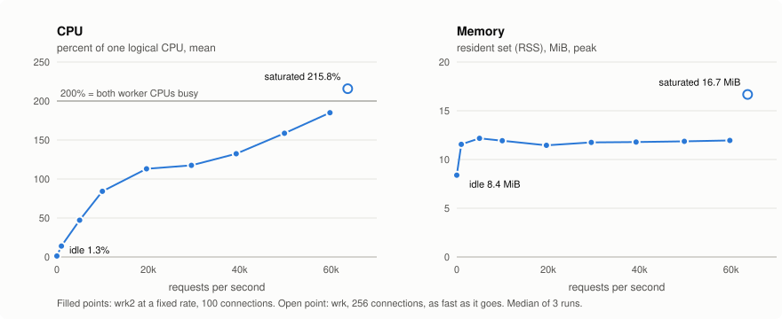

# Naughtian Kallisto - a local, read-only secrets resolver that speaks Vault Kv2 API

<p align="center">
  
  
</p>

<p align="center">
  
</p>

Kallisto runs beside your application on localhost. It answers Vault KV-v2 reads using one encrypted file from an S3-compatible bucket. It cannot write. There is no cluster, database, replication, or admin API.

Adopting it is one line:

```diff
- VAULT_ADDR=https://vault.internal:8200
+ VAULT_ADDR=http://127.0.0.1:8200
```

Removing it is the same line. If your application uses a Vault SDK, it should not notice the difference.

## Status

A prototype under active rework. Not production-ready. Version 1.x makes no stability promise. Do not run this where it matters yet.

`Naughtian Kallisto` is AGPLv3. A commercial licence can be discussed.

## Why use it

When an application constantly re-reads a handful of secrets, a central Vault adds a network round trip to the request path and causes an outage if it becomes unreachable. Kallisto holds the current values locally, refreshes them on a timer, and serves from an encrypted on-disk copy if the bucket goes down.

It is not a Vault replacement.

It has no auth methods, dynamic secrets, leases, PKI, or transit engine. If you need those features, run OpenBao and put Kallisto in front of it.

It reads one file, on the bucket of your choice. S3, R2, MinIO, SeaweedFS, RustFS, the glorious Garage cluster,... Did I miss something?


## How it works

```
  operator                        bucket                      each machine
  ────────                        ──────                      ────────────
  kallisto-ctl seal   ──────►   secrets.kal   ──────►   kallisto-server :8200
    (AES-256-GCM,               (encrypted,             (polls, authenticates,
     version N)                  versioned)              refuses rollbacks,
                                                         serves KV-v2 reads)
                                                              │
                                                     app ─────┘  VAULT_ADDR=127.0.0.1
```

The file carries the secrets, the policies, and a table of keyed token hashes. The policy table is encrypted with everything else. Permission to write to the bucket and possession of the key are two different things. An unencrypted policy table would let whoever holds the bucket write access grant themselves the key.

## Compatibility

| Vault call | Kallisto |
| --- | --- |
| `GET /v1/secret/data/<path>` | `metadata.version` is the file's content version |
| `GET /v1/secret/data/<path>?version=N` | if `N` is the current version, otherwise 404 |
| `GET`/`LIST` `/v1/secret/metadata/<path>` | both spellings; one entry in `versions` |
| `GET /v1/sys/health`, `/v1/sys/seal-status` | real state, plus `kallisto_file_version` |
| `GET /v1/sys/mounts`, `/v1/auth/token/{lookup-self,renew-self}` | Yes. |
| `GET /v1/sys/metrics` | Prometheus metric endpoint |
| `PUT`/`POST`/`PATCH`/`DELETE` on `data` | **403 `permission denied`** |
| `delete` / `undelete` / `destroy` / `subkeys` | **403 `permission denied`** |

The 403s are the point of Kallisto, as it cannot write. A resolver that cannot write is a resolver whose stolen credentials are worth nothing.

Kallisto does not keep version history. The file holds current values only. `?version=N` answers for the current version and returns 404 for anything else. Older values live in your git history and bucket versioning. Kallisto tracks the file's content version to refuse any file older than the one it already holds.

## What it does not protect against

Kindly take these notes seriously:

- **Root on the machine, or anyone reading the process memory.** The in-RAM barrier encrypts secrets between requests and zeroizes the decryption buffer after each response. This makes a core dump or a swap file less rewarding, but it does not stop a live debugger. Nothing at this layer can.
- **A response body in flight.** While a secret is written into an HTTP response, it is cleartext in this process. That is what serving a secret is.
- **Anyone holding the seal key.** They can read the file. The key belongs in your orchestrator's secret store or some other secure storage. Arguments are world-readable through `ps`, which is why the server refuses `--seal-key`.
- **The access log is not an audit log.** It drops lines when its queue fills to keep the machine serving. It cannot tell you with certainty who read what. Alert on `kallisto_access_log_dropped_total`.

## Operational rules

1. **Never expose port 8200 beyond localhost.** There is no network authentication. The server refuses to start on a non-loopback address unless you pass `--i-accept-the-risk`.
2. **Applications must read secrets at runtime.** Do not bake them into a build artefact or a framework cache. Laravel's `config:cache` writes plaintext secrets into `bootstrap/cache`. Doing that defeats the purpose of a resolver.

## Getting started

### Building

For developing and compiling, your instance should have `rustc`, `cargo`, `cmake`, `clang`, and `git` installed. Build tools, `make`, are assumed to be present.

```bash
make dev        # fmt + clippy + cargo-deny + tests, in CI's order
make verify     # ADR-0013's blocking verification suite
make duck       # three real Vault SDKs against the real server
make bench-duck
make bench-profile   # CPU and RAM, idle to saturated, with the chart
```

### Manual testing

Firstly, clone the repository:

```bash
git clone \
	-b main \
	https://github.com/AlexanderSlokov/Naughtian-Kallisto.git \
	kallisto

cd kallisto
```

Then compile it:

```bash
make build
```

Create a seal key and a secrets file:

```bash
export KALLISTO_SEAL_KEY=$(cargo run -q -p kallisto-ctl -- gen-key)
cat > plain.json <<'JSON'
{"version": 1, "secrets": {"app/db": {"username": "admin", "password": "duck-fixture-not-a-credential"}},
 "policies": {}, "tokens": {}}
JSON
```

Seal it up with `kallisto-ctl`:

```bash
cargo run -q -p kallisto-ctl -- seal --in plain.json --out secrets.kal
```

The `.kal` file will be the encrypted file you put on S3 endpoints. Copy it to your bucket, for example, to `s3://my-bucket/secrets.kal`.

Then copy the `kallisto.example.yaml` to `kallisto.yaml` and edit it. Follow the comments in the example file.

> **IMPORTANT**:
> The S3 endpoint must be reachable from the kallisto server and it must support `list-objects` and `head-object` calls.

```bash
cp kallisto.example.yaml kallisto.yaml
```

Now serve with your `kallisto.yaml`:

```bash
cargo run -q -p kallisto-server -- --config kallisto.yaml
```

You can verify its operation and compability with Vault's CLI:

```bash
export VAULT_ADDR=http://127.0.0.1:8200

# works
vault kv get secret/app/db
# 403, by design
vault kv put secret/app/db x=y
# works
curl -s localhost:8200/v1/sys/health | jq .kallisto_file_version
```

## The offline tool

Naughtian Kallisto comes with a CLI tool `kallisto-ctl` for offline operations:

| Command | |
| --- | --- |
| `seal --in plain.json --out secrets.kal [--version N]` | Encrypt the file. But will refuse to create previous versions (preventing rollback). |
| `verify --in secrets.kal` | Check the tag and report counts. No print out secrets or paths. |
| `bump-version --in secrets.kal [--to N]` | Raise the content version of the sealed file in place. |
| `mint-token [--in secrets.kal] --policy <name>` | Generate a token and the table row to paste. Shown once. |
| `gen-key` | Generate 32 bytes of random data from the system RNG. Useful to quickly make a new seal key. |
| `validate --config kallisto.yaml` | Validate the configuration and how the server would operate. |
| `open --in secrets.kal --yes-print-secrets-to-stdout` | Print out secrets to stdout. Very discouraged to use as it makes secrets appear in shell history, etc. |

## Resource footprint

The server and the load generator share one machine and a desktop session was running during the measurement, so treat these as the order of magnitude, not a figure to size a fleet by.

To measure your own machine, run `make bench-profile`. It writes its results under `target/bench/`.

### Setups

The author measured the resource footprint on a `HP Pavilion Gaming 15-ec0xxx`. In details:

- CPU: `AMD Ryzen 5 3550H (4 cores, 8 threads)`
- RAM: 13 GiB visible to the OS
- OS: Ubuntu 24.04 LTS

The configuration:

- 2 workers
- Access log on
- Serving a file of 64 secrets
- The rate limiter is lifted so that the serving path is measured, not the token bucket.
- The server runs on logical CPUs 0-3 and the load generator on 4-7 of the same machine.

### Results

The binary is 7.5 MiB (5.7 MiB stripped). `kallisto-ctl` is 2.4 MiB. Linked with `libc` and `libgcc_s`.

The figures in this below table are the median of 3 runs:

| State | Requests per second | RAM (RSS) | CPU, % of one logical CPU | Latency p50 / p99 |
| --- | --- | --- | --- | --- |
| Idle | 0 | 8.3 MiB | 0.0% | - |
| Stress | 39,247 | 11.8 MiB | 132% | 1.35 ms / 3.22 ms |
| Saturated | 63,648 | 16.7 MiB | 216% | 4.04 ms / 6.04 ms |

Stress is 40,000 requests per second because that is the most the default configuration will ever occour: 20,000 per worker, 2 workers. Saturated is `wrk` with 256 connections.

> NOTE: The `idle` row is from 2.0.1. The `stress` and `saturated` rows, and the sweep below, were measured on 2.0.0.

> Version 2.0.1 of Naughtian Kallisto changed when the log writer sleeps and which CPUs the workers are pinned to, but the benchmark was not run again since. However, a comparison of saturated vs saturated has shown that the new pinning gives ~2% more throughput, from 57k to 58.3k requests per second, while using 4% less CPU, from 215% to 208%.



| Offered rate | Served | RAM (RSS) | CPU | CPU per request | p50 | p99 |
| --- | --- | --- | --- | --- | --- | --- |
| 1,000 | 982 | 11.6 MiB | 14% | 143 us | 1.02 ms | 2.62 ms |
| 5,000 | 4,981 | 12.2 MiB | 47% | 95 us | 1.07 ms | 2.34 ms |
| 10,000 | 9,960 | 11.9 MiB | 84% | 85 us | 1.44 ms | 3.02 ms |
| 20,000 | 19,623 | 11.5 MiB | 113% | 58 us | 1.67 ms | 3.82 ms |
| 30,000 | 29,434 | 11.8 MiB | 118% | 40 us | 1.32 ms | 4.13 ms |
| 40,000 | 39,247 | 11.8 MiB | 132% | 34 us | 1.35 ms | 3.22 ms |
| 50,000 | 49,793 | 11.9 MiB | 159% | 32 us | 1.27 ms | 4.48 ms |
| 60,000 | 59,752 | 12.0 MiB | 185% | 31 us | 1.42 ms | 6.61 ms |

All requests are answered with code `200` status.

What the numbers say:

- RAM does not grow with load. It sits near 12 MiB from 1,000 to 60,000 requests per second. The step to 16.7 MiB at saturation comes with 256 open connections instead of 100.

- The ceiling is the server's, not the load generator's. At saturation both worker threads are fully busy, while wrk used about half of the four CPUs it had. Until 2.0.1 the two workers were pinned to logical CPUs 0 and 1, which on this machine are the two hardware threads of one physical core, so the default configuration served the whole of that from a single core. They now take one physical core each, stay inside whatever affinity mask the process was given, and leave CPU 0 alone where they can.

- CPU per request falls as load rises, from 143 us at 1,000 requests per second to 31 us at 60,000. The likely reason is that a request arriving alone pays for waking a worker and the log writer by itself, while under load one wake-up serves many. This has not been measured separately.

- Idle is zero, as of 2.0.1. The access log writer used to sleep at most 1 ms and look again, waking about a thousand times a second and costing 1.3% of a logical CPU on a resolver nobody was calling. It now parks once the queue has been empty for 50 ms, and a worker wakes it. The wait is 50 ms as parking the moment the queue ran dry put a futex wake on the read path, once per request, and measured 5% slower.

## Documentation

Start at [docs/README.md](docs/README.md).

Take a look at [docs/references/ADRs/](docs/references/ADRs/) for the design decisions.

[docs/references/verification-status.md](docs/references/verification-status.md) for independent verification.

Guides for running Kallisto live at [docs.naughtian.org/kallisto](https://docs.naughtian.org/kallisto/).
